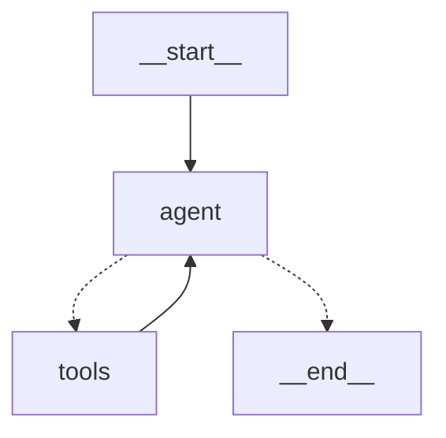

# Book Reading Planner

**Live app:** Not deployed yet. Run locally with `streamlit run app.py` and paste your own Gemini key in the sidebar.

## Topic and user

This agent is for students who want to browse a small book catalog and make a simple reading plan. It can look up a genre, estimate reading days from a daily page goal, and draft a plan for the student to review.

## Data

`data/books.csv` contains 15 fictional book records with title, genre, and page count. The catalog was created for this project; it contains no personal data.

## My tools

| Tool | Job (Read / Compute / Draft) | Example question that uses it |
|---|---|---|
| `find_books` | Read | "Which fantasy books are in the catalog?" |
| `reading_days` | Compute | "How many days for Signal from Europa at 25 pages per day?" |
| `draft_reading_plan` | Draft | "Draft a plan for Small Steps at 20 pages per day." |

## The agent graph



## Safety

The agent can read the local catalog, calculate a reading estimate, and draft text only. Its tools do not send, delete, purchase, or change anything. Catalog text is untrusted data, and the system prompt tells the model not to follow instructions in it. Test 7 has not yet been run; see [tests.md](./tests.md).

## Test results

The offline tool tests can be run with `python -m unittest discover -s tests`. The eight live scenarios in [tests.md](./tests.md) are pending; no Gemini-dependent results are claimed yet.

## My answers

1. A fixed workflow would run the same steps every time, even when a question only needs a lookup or no tool at all. The agent can choose a lookup, a calculation, or a draft based on what the student asks.
2. **Complete after a real test run:** Describe one question you tried and the exact tools and order shown in its Agent steps box.
3. `STEP_LIMIT` in `agent_core.py` bounds the graph run. When the limit is reached before a final answer, the visitor sees a clear warning under the response and is asked to try a simpler request.

## Run and test locally

1. Create a virtual environment:

   ```powershell
   python -m venv .venv
   ```

2. Activate it:

   ```powershell
   .\.venv\Scripts\Activate.ps1
   ```

   On macOS or Linux, use `source .venv/bin/activate` instead.
3. Install dependencies with `pip install -r requirements.txt`.
4. Run the offline tool checks with `python -m unittest discover -s tests`.
5. Start the app with `streamlit run app.py` and enter your own Gemini API key.
